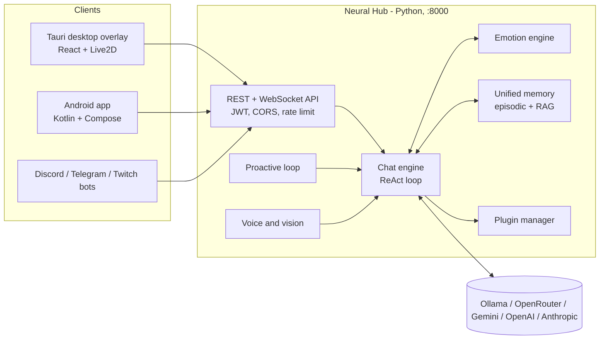

<div align="center">


# Project Aiko

Self-hosted AI companion with emotion modeling, long-term memory, voice, vision, and permission-gated tool use.

[](LICENSE)
[](https://python.org)
[](https://github.com/omax404/Project-Aiko/actions/workflows/ci.yml)
[](https://discord.gg/8kNMMwFjcG)

</div>


## Overview

Aiko runs on your own machine. A Python backend (the Neural Hub) handles reasoning, memory, speech and vision, and exposes a REST and WebSocket API on port 8000. Clients connect to it: a Tauri desktop overlay with a Live2D avatar, an Android app, and Discord, Telegram and Twitch bots.

The model backend is configurable. Aiko works with Ollama, OpenRouter, Gemini, OpenAI, Anthropic, or any custom endpoint.

## Features

- **Reasoning:** ReAct agent loop with tool use, streaming across multiple providers, and rolling conversation windows with summarization.
- **Memory:** Episodic history plus semantic retrieval (RAG), with background consolidation into long-term profile knowledge. Writes are protected by multi-process file locks.
- **Emotion model:** Neuromodulator-based state (dopamine, serotonin, cortisol, adrenaline) mapped to 20+ emotion tags that drive avatar expression and voice inflection.
- **Voice:** Local text-to-speech with Pocket-TTS and local speech recognition with Moonshine, with voice activity detection and a SpeechRecognition fallback.
- **Vision:** Screen and image analysis with local models (`moondream`, MiniCPM-V). Heavy work runs in worker threads so the event loop stays responsive.
- **Proactive behavior:** An autonomous loop decides when to speak, observe, reflect or consolidate memory.
- **Plugins:** Modular plugin manager with file, clipboard and process tools, plus Spotify, Obsidian, LaTeX, MQTT/IoT and game-server (`GameBridge`) integrations.

## Platforms

| Component | Stack | Notes |
|---|---|---|
| Desktop app | Tauri v2, React 19, Live2D | Click-through overlay, global hotkey `Ctrl+Alt+A` |
| Android app | Kotlin, Jetpack Compose, Room | OpenGL ES 2.0 Live2D renderer, WebRTC state sync |
| Discord bot | Satellite | Voice transcription, image recognition |
| Telegram bot | Satellite | Direct messaging |
| Twitch bot | Satellite | Stream chat responses |
| API | REST + WebSocket, port 8000 | JWT auth, CORS origin checks, rate limiting |

## Installation

### Requirements

- Python 3.11–3.12 (3.13 is not supported)
- Node.js and Rust toolchain, for building the desktop app from source
- Windows (primary target, covers the one-click launcher and release builds) or Linux (exercised in CI). macOS is untested.

On Linux, install the audio and OpenCV system libraries first:

```bash
sudo apt-get update && sudo apt-get install -y portaudio19-dev libgl1 libglib2.0-0
```

### Windows quick start

1. Clone or download this repository.
2. Run `LAUNCH_AIKO.bat`. It creates the virtual environment, installs dependencies and starts the desktop app.
3. Open **Settings** (gear icon) to choose a model provider, voice and plugins, then click **Save & Apply**.

### From source

```bash
git clone https://github.com/omax404/Project-Aiko.git
cd Project-Aiko

python -m venv .venv
source .venv/bin/activate        # Windows: .\.venv\Scripts\activate
pip install -r requirements.txt

cp .env.example .env             # add provider keys as needed
python launch.py
```

`launch.py` starts the Neural Hub, connects configured satellites and opens the desktop overlay.

For reproducible installs with hash verification:

```bash
pip install --require-hashes -r requirements.lock
```

`requirements.in` is the editable manifest and `requirements.lock` is generated from it. Development tools (`pytest`, `ruff`, `mypy`, `pre-commit`) are in the `dev` extra: `pip install -e ".[dev]"`.

### Desktop app only

```bash
cd aiko-app
npm ci
npm run tauri dev     # native window
npm run dev           # browser-only Vite server
npm run build         # production frontend bundle
```

## Configuration

Provider keys and tokens go in `.env` (template: [`.env.example`](.env.example)). Optional overrides go in `user_settings.json` in the project root (template: [`user_settings.example.json`](user_settings.example.json)). Known credential keys are masked in settings API responses.

## Security

Aiko can control the machine it runs on, so sensitive actions are gated.

- **Human-in-the-loop approval:** GUI actions (`OPEN`, `CLICK`, `TYPE`, `PRESS`), privacy-sensitive reads (`SCAN`, `CAMERA`, `EMAIL_INBOX`), `EMAIL_SEND` and sensitive MCP tools (file writes and deletes, process kill, command execution, clipboard writes) wait for approval from the originating client, with a 30-second timeout. Enforcement is server-side and applies to administrative tokens too.
- **Local authentication:** Bearer tokens are HS256 JWTs that expire after at most 24 hours. The local token endpoint serves loopback clients only; remote or proxied requests are rejected with `403`.
- **Typed boundaries:** Pydantic v2 validates API and WebSocket input on the server; Zod validates payloads on the client. The desktop client builds with TypeScript `strict` and `noUncheckedIndexedAccess`.

See [SECURITY.md](SECURITY.md) for the full threat model and enforcement rules.

## Development

### Tests

```bash
pytest tests/                    # backend
pytest tests/ --cov=core         # with coverage

cd aiko-app
npm test                         # Vitest
npx tsc --noEmit                 # type check
```

### Continuous integration

[`ci.yml`](.github/workflows/ci.yml) runs on pushes to `main` and `develop`, and on pull requests to `main`:

| Job | Checks |
|---|---|
| `test-python` | Python 3.10, 3.11, 3.12 matrix; `ruff` (fatal rules); `pytest` with a coverage floor |
| `test-frontend` | `npm ci`, `tsc --noEmit`, Vitest, production build |
| `security-scan` | `bandit` on `core/`; high-severity findings fail the job |
| `release` | On `v*` tags: builds the PyInstaller sidecar and Tauri installers, attaches them to a GitHub release |

### Repository layout

```text
core/          Backend: API, orchestration, memory, emotion, voice, vision
aiko-app/      Tauri v2 + React desktop client (src-tauri/ holds the Rust side)
android/       Android client
plugins/       Plugin packages (IoT)
tests/         Backend test suite
directives/    Agent skills and personas
docs/          Guides and API reference
launch.py      Cross-platform launcher
```

## Documentation

- [User manual](docs/USER_MANUAL.md)
- [API reference](docs/API_REFERENCE.md)
- [Security policy](SECURITY.md)
- [Contributing guide](CONTRIBUTING.md)

## Troubleshooting

| Problem | Fix |
|---|---|
| Launcher exits immediately | Confirm Python 3.11–3.12 is on `PATH`. Python 3.13 lacks wheels for some dependencies. |
| `Failed to build wheel` / `cl.exe` not found | Install [Visual C++ Build Tools](https://visualstudio.microsoft.com/visual-cpp-build-tools/) with the "Desktop development with C++" workload. |
| "Brain not ready" | Start Ollama (`ollama serve`) or set an API key in **Settings**. |
| Port 8000 or 1422 in use | Stop the stale Python or Node process holding it. |

## Contributing

Pull requests are welcome. Read [CONTRIBUTING.md](CONTRIBUTING.md) for code standards and workflow.

## License

Released under the [MIT License](LICENSE).

## Architecture


